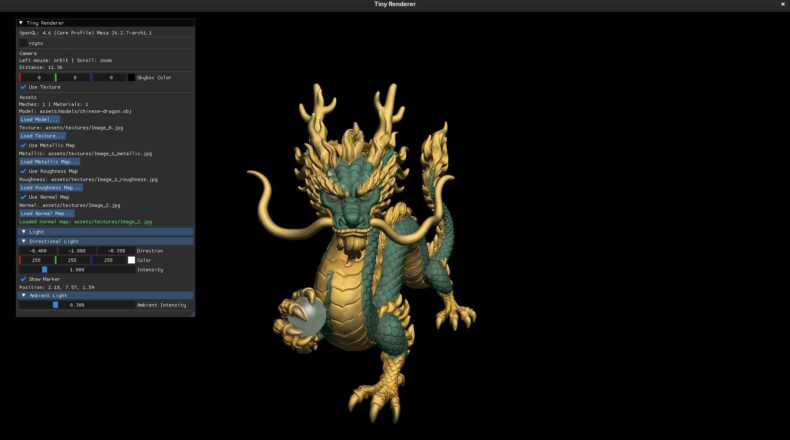
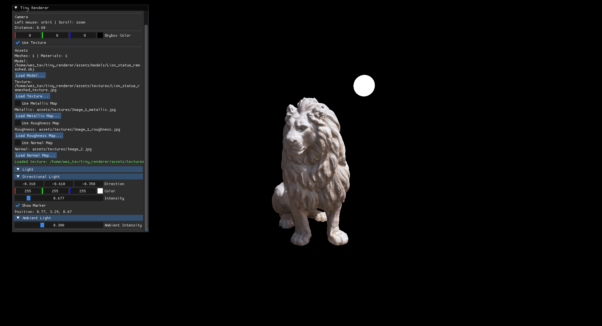

# Tiny Renderer

A Small OpenGL renderer to study and apply some concepts

[1.Requirements](#Requiments)

[2.Build](#Build)

[3.Pictures](#Pictures)

-----
### 1.Requirements

- Cmake
- OpenGL
- C++ Compiler
- Git

-----

### 2.Build
*Linux:*

    cmake -S . -B build
    cmake --build build/ -j
    ./build/tiny_renderer

*Windows (cross-compile from Linux with MinGW-w64):*

    cmake -S . -B build-windows -DCMAKE_TOOLCHAIN_FILE=cmake/mingw-w64-x86_64.cmake
    cmake --build build-windows/ -j

The executable is `build-windows/tiny_renderer.exe`; keep the `assets/` folder
next to it when running on Windows.
-----

### 3.Pictures

