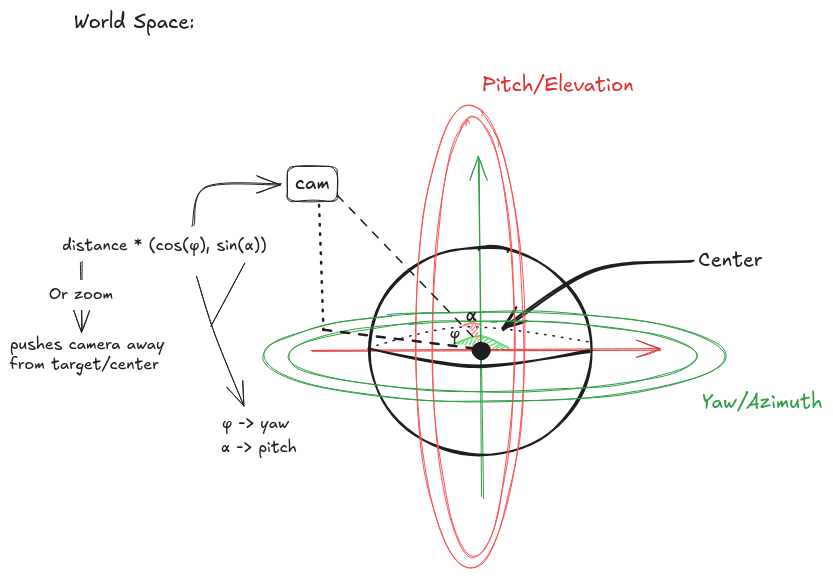
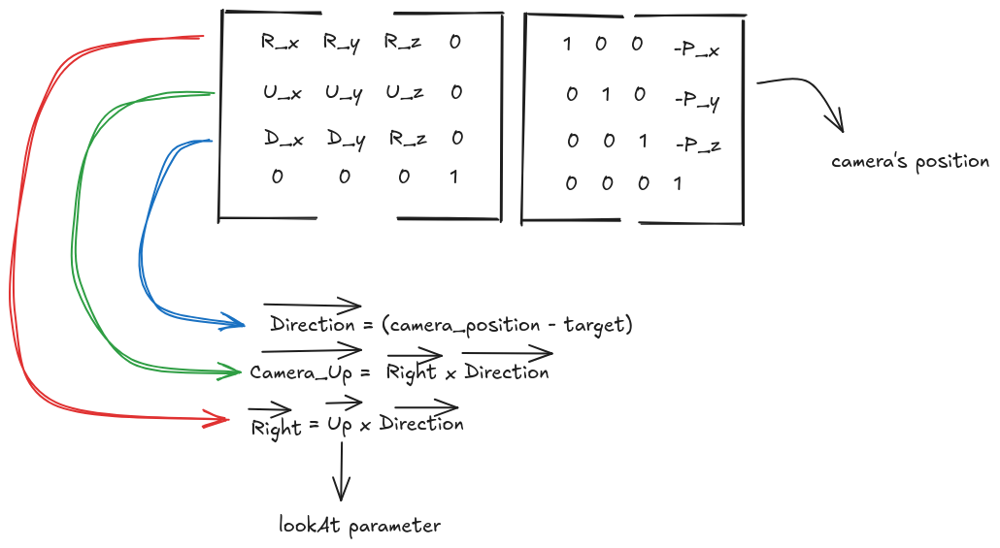

# Tiny Renderer

Small renderer with some fundamental features and concepts applied.

## Summary
[1.Requirements](#Requiments)

[2.Build](#Build)

[3.Camera](#Camera)

-----
### 1.Requirements

- Cmake
- OpenGL
- C++ Compiler
- Git

### 2.Build
*Linux:*

    cmake -S . -B build
    cmake --build build/ -j
    ./build/tiny_renderer

-----
### Camera
A simple Orbit Camera using Euler angles with two degrees of freedom, that is, allowed to perform only azimuth (rotation about vertical axis or _yaw_) and elevation (rotation about horizontal axis or _pitch_) around a center/target object.

#### View
The final _view_ matrix is done using a GLM function:
```C++
    glm::lookAt(position, target, {0.0f, 1.0f, 0.0f})
```
Mathematically it produces and calculates the product of the below matrices:


#### Perspective Projection
Uses a built-in GLM function that uses fov, aspect, near and far planes.
```C++
    glm::perspective(fov, aspect, near, far);
```