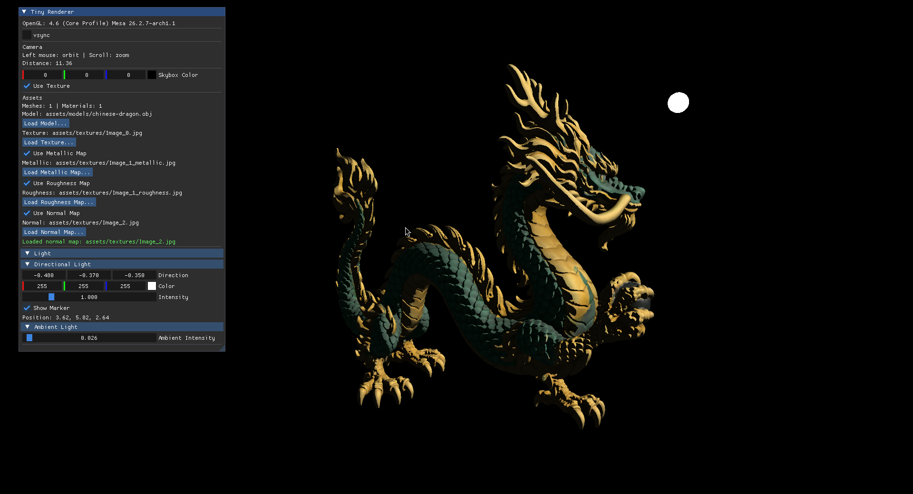
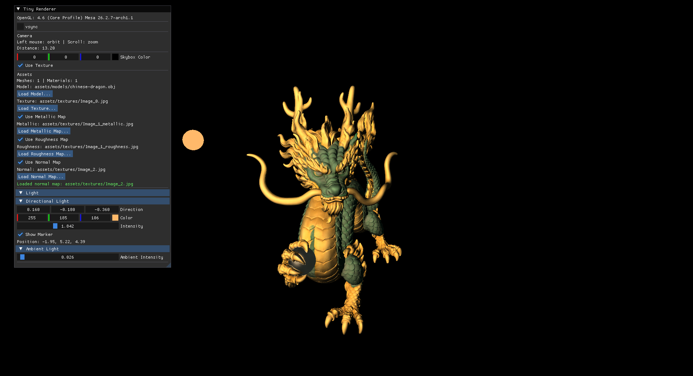

# Tiny Renderer

A Small OpenGL renderer to study and apply some concepts

[1.Requirements](#Requiments)

[2.Build](#Build)

[3.Pictures](#Pictures)

-----
### 1.Requirements

- Cmake
- OpenGL
- C++ Compiler
- Git

-----

### 2.Build
*Linux:*

    cmake -S . -B build
    cmake --build build/ -j
    ./build/tiny_renderer
-----

### 3.Pictures

